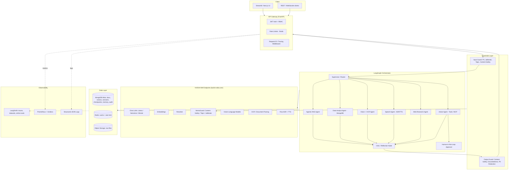
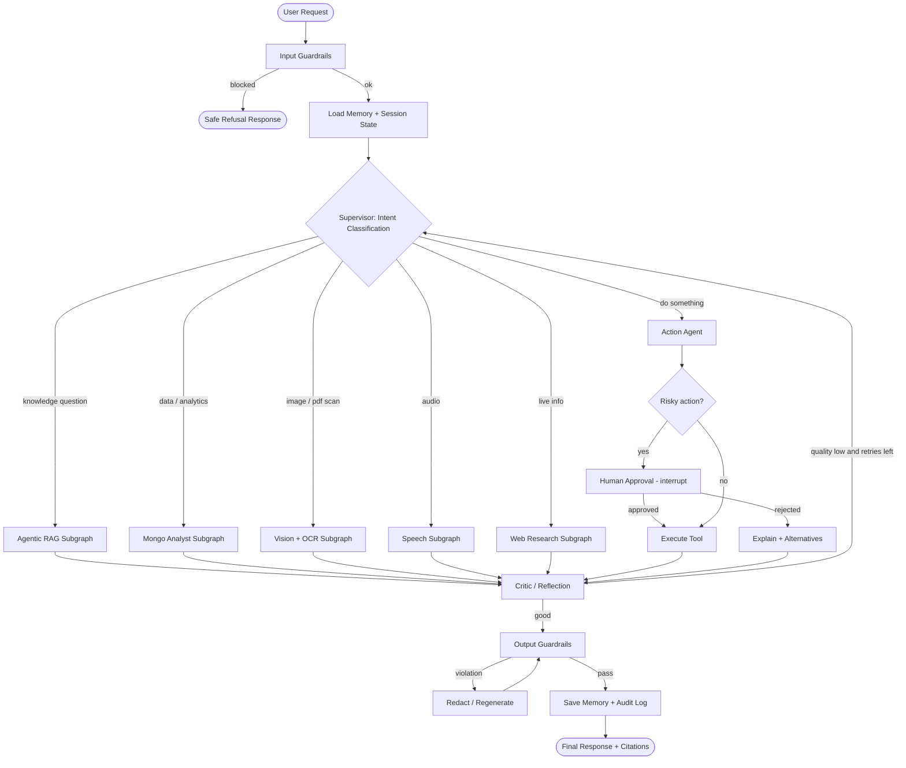
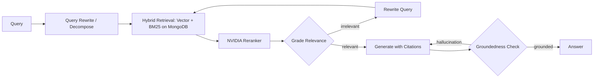

# MASTER PROMPT FOR CLAUDE CODE — "NIM Sentinel"
### Enterprise Multi-Agent Knowledge & Operations Copilot (LangGraph + LangChain + NVIDIA NIM + MongoDB + LangSmith)

> How to use: open an empty repo in VS Code, start Claude Code, paste everything under **"=== PROMPT START ==="**.
> Tip: first run `/plugin` check that Ponytail, Graphify, Agent Skills and Context7 are active. Then paste the prompt. Claude Code will work phase by phase and stop for your approval after each phase.

---

## QUICK PICTURE OF THE PROJECT

**NIM Sentinel** is a multi-agent copilot for a company. Employees upload documents (PDF, images, audio, CSV) and ask questions or give tasks. A **LangGraph supervisor** routes the request to specialist agents (Agentic RAG, SQL/Mongo analyst, Vision/OCR, Speech, Web research, Action/tool agent). Everything is protected by **input/output guardrails**, traced by **LangSmith**, evaluated by a **component-wise eval suite**, and shipped through **CI/CD**.

### System architecture



### LangGraph main flow



### Agentic RAG subgraph



### CI/CD pipeline

```mermaid
flowchart LR
    DEV[Push / PR] --> LINT[Ruff + Black + Mypy]
    LINT --> SEC[Bandit + pip-audit + Gitleaks + Trivy]
    SEC --> UT[Unit Tests]
    UT --> IT[Integration Tests - Mongo/Redis containers]
    IT --> EV[Eval Suite Gate - component + e2e]
    EV -->|score below threshold| FAIL([Block Merge])
    EV -->|pass| BUILD[Docker Build + SBOM]
    BUILD --> PUSH[Push to GHCR]
    PUSH --> STG[Deploy Staging]
    STG --> SMOKE[Smoke + Red-team Tests]
    SMOKE --> APPROVE{Manual Approval}
    APPROVE --> PROD[Deploy Production - rolling/canary]
    PROD --> MON[LangSmith Online Evals + Grafana Alerts]
    MON -->|regression| ROLL[Auto Rollback]
```



---

# === PROMPT START ===

You are a senior staff AI engineer. Build a complete, production-grade GenAI platform called **NIM Sentinel**. The final repo must look like it was built by a GenAI engineer with 3+ years of real production experience: clean architecture, typed code, tests, docs, observability, safety and CI/CD, with no toy shortcuts.

## 0. WORKING RULES (follow strictly)

1. **Use my installed tools.**
   - Use **Context7** to fetch the latest docs for `langgraph`, `langchain`, `langchain-nvidia-ai-endpoints`, `langsmith`, `pymongo`/`motor`, `langchain-mongodb`, `fastapi`, `nemoguardrails` BEFORE writing code against them. Do not rely on memory for APIs or model names.
   - Use **Graphify** to build and keep updated a knowledge graph of the codebase; run it after each phase and save the output in `docs/graph/`. Use it to check for circular imports, dead code and module coupling.
   - Use **Ponytail** to keep tasks small, focused, and reviewable; use **Agent Skills** where relevant (testing, code review, docs).
2. **Work in phases.** After each phase: run tests/lint, update `docs/PROGRESS.md`, commit with Conventional Commits, show me a short summary, and **wait for my "continue"**.
3. **No hardcoded secrets or model names in code.** Everything comes from `.env` + `configs/*.yaml`.
4. **Python 3.11+**, `uv` or `poetry` for dependencies, full type hints, Pydantic v2 everywhere, async-first.
5. **Every external call** (NVIDIA, MongoDB, web) must have timeouts, retries with exponential backoff, and structured error handling.
6. Write a short ADR (Architecture Decision Record) in `docs/adr/` for each major decision.
7. If something is ambiguous, pick the production-sensible default, document it, and move on.

## 1. TECH STACK

| Area | Choice |
|---|---|
| Orchestration | **LangGraph** (StateGraph, subgraphs, conditional edges, checkpointer, `interrupt` for HITL, streaming) |
| LLM framework | **LangChain** (LCEL, tools, structured output, retrievers, callbacks) |
| Models | **NVIDIA NIM endpoints** via `langchain-nvidia-ai-endpoints` (`ChatNVIDIA`, `NVIDIAEmbeddings`, `NVIDIARerank`) and NVIDIA hosted APIs |
| Database | **MongoDB** (Atlas Vector Search + full-text; collections for docs, chunks, sessions, LangGraph checkpoints, long-term memory, audit logs, eval results) |
| Cache / limits | Redis |
| API | FastAPI (async), SSE + WebSocket streaming, OpenAPI docs |
| UI | Streamlit (simple) or Next.js (preferred if time) with streaming chat and trace viewer |
| Guardrails | NeMo Guardrails + NVIDIA NemoGuard NIMs + custom validators |
| Observability | **LangSmith** (tracing, datasets, online evaluators), Prometheus, Grafana, OpenTelemetry, structlog |
| Evals | pytest + LangSmith `evaluate()` + RAGAS/DeepEval-style custom metrics |
| Packaging | Docker multi-stage, docker-compose (dev), Helm chart or Kubernetes manifests (prod) |
| CI/CD | GitHub Actions |
| Quality | Ruff, Black, Mypy (strict), pre-commit, Bandit, pip-audit, Gitleaks, Trivy |

## 2. USE ALL TYPES OF NVIDIA MODELS (config-driven model registry)

Create `configs/models.yaml` and a `ModelRegistry` class that maps **roles → NVIDIA model IDs**, so models can be swapped without code changes. First, use Context7/NVIDIA docs/`ChatNVIDIA.get_available_models()` to **verify currently available model IDs**, then fill the registry. Cover these roles:

| Role | Purpose | Example families to look for on build.nvidia.com |
|---|---|---|
| `supervisor_llm` | routing, planning (small, fast, low temp) | Llama 3.x 8B/70B Instruct, Nemotron |
| `reasoning_llm` | complex reasoning, critic, planning | Llama 3.3 70B, Nemotron Super/Ultra, reasoning-tuned models |
| `generator_llm` | final answer generation | Llama / Mistral / Nemotron instruct |
| `code_llm` | SQL/Mongo query generation, code tools | code-specialized models (e.g., Qwen coder / Codestral class) |
| `embedding` | document + query embeddings | NV-EmbedQA / Llama-Nemotron embed models |
| `reranker` | rerank retrieved chunks | NV-RerankQA / Llama-Nemotron rerank |
| `vision_llm` | image understanding, chart/table reading | Llama 3.2 Vision / Nemotron VL |
| `ocr` / `doc_parser` | scanned PDFs, tables, forms | NeMo Retriever OCR / page-elements / table-structure NIMs |
| `asr` / `tts` | speech in/out | NVIDIA Riva (Parakeet/Canary ASR, FastPitch/Magpie TTS) |
| `safety_content` | content safety classification | Llama-3.1-NemoGuard content safety |
| `safety_topic` | topic control | NemoGuard topic control |
| `safety_jailbreak` | jailbreak detection | NemoGuard jailbreak detect |
| `judge_llm` | LLM-as-judge for evals (different from generator) | strongest available reasoning model |

Requirements:
- Fallback chain per role (primary → secondary model) with circuit breaker.
- Per-role token budget, temperature, timeout in YAML.
- Cost + latency tracking per model role (tokens in/out, ms) pushed to LangSmith metadata and Prometheus.
- A `scripts/check_models.py` that pings every configured model and prints a health table.

## 3. REPOSITORY STRUCTURE

```
nim-sentinel/
├── .github/workflows/        # ci.yml, eval-gate.yml, cd-staging.yml, cd-prod.yml, security.yml, nightly-evals.yml
├── configs/                  # models.yaml, guardrails.yaml, agents.yaml, eval_thresholds.yaml, logging.yaml
├── deploy/
│   ├── docker/               # Dockerfile (multi-stage), docker-compose.yml, docker-compose.test.yml
│   ├── k8s/ (or helm/)       # deployment, service, hpa, ingress, configmap, secrets template
│   └── grafana/              # dashboards JSON
├── docs/
│   ├── architecture.md, PROGRESS.md, runbook.md, security.md, eval-strategy.md
│   ├── adr/                  # architecture decision records
│   ├── diagrams/             # mermaid files exported
│   └── graph/                # Graphify output
├── src/nim_sentinel/
│   ├── api/                  # FastAPI app, routers, deps, middleware, schemas
│   ├── core/                 # config, logging, errors, security, constants
│   ├── llm/                  # model_registry.py, factories, fallbacks, callbacks, cost_tracker
│   ├── graph/
│   │   ├── state.py          # typed GraphState (TypedDict/Pydantic) with reducers
│   │   ├── supervisor.py
│   │   ├── main_graph.py
│   │   ├── subgraphs/        # rag.py, data_analyst.py, vision.py, speech.py, web.py, action.py
│   │   ├── nodes/            # critic.py, memory.py, hitl.py, guard_nodes.py
│   │   └── checkpointer.py   # MongoDB checkpointer
│   ├── tools/                # base.py, registry.py, mongo_query.py, web_search.py, calculator.py, doc_ops.py, email_draft.py, calendar_stub.py, mcp_client.py
│   ├── rag/                  # ingestion/, chunking/, indexer.py, retriever.py (hybrid), reranker.py, citations.py
│   ├── memory/               # short_term.py, long_term.py (MongoDB), summarizer.py
│   ├── guardrails/           # input_guard.py, output_guard.py, pii.py, jailbreak.py, groundedness.py, policies/, rails/ (colang)
│   ├── observability/        # langsmith_setup.py, decorators.py, metrics.py, otel.py, online_eval.py
│   ├── db/                   # mongo client, repositories, indexes, migrations
│   ├── prompts/              # versioned prompt templates (.jinja/.yaml) + loader
│   └── utils/
├── evals/
│   ├── datasets/             # golden JSONL per component + e2e + adversarial
│   ├── components/           # test_router.py, test_retriever.py, test_reranker.py, test_generator.py, test_guardrails.py, test_tools.py, test_vision.py, test_memory.py
│   ├── e2e/                  # trajectory + final-answer evals
│   ├── evaluators/           # reusable evaluators (faithfulness, relevance, tool-correctness, safety...)
│   ├── redteam/              # jailbreak / prompt-injection / PII-leak suites
│   ├── run_evals.py          # CLI: run all / one component, push to LangSmith, enforce thresholds
│   └── reports/
├── tests/                    # unit/ integration/ contract/ load/ (locust)
├── scripts/                  # seed_data.py, ingest.py, check_models.py, create_indexes.py, export_langsmith_dataset.py
├── ui/
├── Makefile, pyproject.toml, .env.example, .pre-commit-config.yaml, README.md, SECURITY.md, CONTRIBUTING.md
```

## 4. CORE FEATURES TO IMPLEMENT

### 4.1 LangGraph orchestration
- Typed `GraphState` (messages, user_id, session_id, intent, plan, retrieved_docs, tool_calls, guard_flags, retries, citations, cost, trace_id).
- **Supervisor** with structured-output routing (Pydantic schema) + confidence score; low confidence → clarification question.
- **Subgraphs** for each specialist agent, each independently testable and compiled.
- **Reflection/Critic loop** with max-retry cap; critic uses `reasoning_llm` and scores answer on groundedness, completeness, safety.
- **Human-in-the-loop** via `interrupt()` for risky tools (send email, write to DB, delete) with resume API endpoint.
- **MongoDB checkpointer** for durable state, resume, time-travel/replay of any thread.
- Streaming of node-level events + token streaming to the client.
- Parallel fan-out (Send API) for multi-document / multi-question decomposition.

### 4.2 Agentic RAG
- Ingestion pipeline: file → parse (PDF/DOCX/CSV/images via NVIDIA OCR/VLM) → clean → semantic chunking with metadata → embed (batch, async) → store in MongoDB with vector + text indexes.
- Hybrid retrieval (vector + keyword, RRF fusion) + metadata filters (tenant, doc type, date) + **NVIDIA reranker**.
- Query rewrite, decomposition, HyDE (optional), relevance grading, hallucination grading, citation generation with chunk IDs.
- Multi-tenant isolation enforced at the repository layer.

### 4.3 Agents and tools
- **Data Analyst Agent**: natural language → safe MongoDB aggregation pipeline (read-only allowlist, schema-aware, query validator, row limits) → result summary + optional chart spec.
- **Vision Agent**: image/chart/table/invoice understanding using `vision_llm` + OCR.
- **Speech Agent**: audio in (Riva ASR) → graph → text out (+ optional TTS).
- **Web Research Agent**: search + fetch + summarize with source tracking and domain allow/deny list.
- **Action Agent**: tool registry with Pydantic arg schemas, permission scopes per role, dry-run mode, idempotency keys, audit trail. Include an **MCP client adapter** to plug external tools.
- Tool errors must be fed back to the agent for self-correction (bounded).

### 4.4 Memory
- Short-term: thread state via checkpointer, with automatic summarization when context exceeds budget.
- Long-term: user preferences and facts in MongoDB with embeddings; write only after guardrail + PII check; user can view/delete memory (GDPR-style endpoint).

### 4.5 API (FastAPI)
- `/v1/chat` (sync), `/v1/chat/stream` (SSE), `/v1/ws/chat`, `/v1/documents` (upload/list/delete), `/v1/threads/{id}` (history/replay), `/v1/approvals/{id}` (HITL), `/v1/feedback` (thumbs → LangSmith feedback), `/healthz`, `/readyz`, `/metrics`.
- JWT auth, RBAC (admin/analyst/viewer), per-user rate limiting (Redis), request-size limits, CORS config, idempotency keys, correlation IDs.

## 5. SAFETY GUARDRAILS (defense in depth)

Implement as a dedicated `guardrails` package, wired as graph nodes AND API middleware:

**Input guards**
1. Prompt-injection and jailbreak detection (NVIDIA NemoGuard jailbreak NIM + heuristic patterns).
2. Content-safety classification (NemoGuard content safety).
3. Topic control (stay in enterprise-assistant scope).
4. PII detection/redaction (Presidio or regex+LLM) before logging and before sending to external tools.
5. Indirect prompt-injection defense for retrieved docs / web pages (treat as untrusted data, delimiter isolation, strip instructions, tool-call confirmation).
6. Input size, language, and file-type validation (magic-bytes check, malware scan hook).

**Output guards**
1. Content-safety on output.
2. Groundedness/hallucination check against retrieved context; if ungrounded → regenerate or say "I don't know".
3. PII/secret leakage filter (API keys, emails, phone, Aadhaar/SSN patterns).
4. Citation requirement for knowledge answers.
5. Schema validation for structured outputs.

**Tool/Action safety**
- Allowlist-only tools, per-role permissions, argument validation, read-only Mongo mode, max steps/loops, max token + cost budget per request, human approval for destructive actions, full audit log.

**Governance**
- `configs/guardrails.yaml` policies, versioned; every guard decision logged (reason, score, action) and sent to LangSmith as run metadata + feedback.
- Red-team suite in `evals/redteam/` run in CI (jailbreaks, injection, PII exfiltration, tool abuse, toxic output) with a **max allowed attack-success-rate threshold**.

## 6. OBSERVABILITY: LANGSMITH ONLINE MONITORING WITH DECORATORS

Build `src/nim_sentinel/observability/decorators.py`:

```python
# Required decorators (implement them properly, sync + async support, preserve signatures with functools.wraps)
@traced_component(name="retriever", run_type="retriever", tags=["rag"], capture_io=True, redact_pii=True)
@traced_node(name="supervisor")          # for LangGraph nodes: adds state keys, intent, route decision
@traced_tool(name="mongo_query", risk="low")  # tool latency, args (redacted), success/failure
@traced_llm_call(role="generator_llm")   # model id, tokens, latency, cost, fallback used
@guard_trace(guard="input_jailbreak")    # records guard score + decision
@monitored(slo_ms=3000, alert_on_error=True)  # emits Prometheus metrics + LangSmith metadata
```

Implementation notes:
- Wrap `langsmith.traceable` underneath; add consistent metadata: `user_id_hash`, `tenant`, `session_id`, `graph_version`, `prompt_version`, `model_role`, `model_id`, `env`, `git_sha`.
- **Never log raw PII** — redact via the PII module before attaching inputs/outputs.
- Configure LangSmith project per environment (`nim-sentinel-dev|staging|prod`), sampling rate configurable (100% staging, e.g. 20% prod + 100% on errors/guard-blocks).
- **Online evaluators** (LangSmith automations/rules) on production traces: faithfulness/groundedness, answer relevance, toxicity/safety, PII-leak, tool-call correctness, latency & cost anomalies. Implement code in `online_eval.py` and document how to register rules.
- User feedback endpoint → `client.create_feedback()` linked to run_id.
- Trace → dataset flywheel: script that promotes low-score or thumbs-down production traces into a LangSmith dataset for regression testing.
- Prometheus metrics: request count/latency (p50/p95/p99), per-node latency, per-model tokens/cost, guard block rate, retry rate, fallback rate, HITL pending count. Provide Grafana dashboard JSON + alert rules.
- OpenTelemetry trace context propagated from API → graph → tools.

## 7. COMPONENT-BASED EVAL SUITE

Evaluate **each component in isolation, then end-to-end**. Each component gets a golden dataset (JSONL, at least 30–50 examples, include edge/adversarial cases), evaluators, metrics and thresholds from `configs/eval_thresholds.yaml`.

| Component | Metrics |
|---|---|
| Supervisor/Router | routing accuracy, confusion matrix, clarification rate, latency |
| Query rewriter | retrieval lift vs raw query |
| Retriever (hybrid) | recall@k, MRR, nDCG, hit-rate |
| Reranker | nDCG lift vs no-rerank, latency |
| Generator | faithfulness, answer relevance, completeness, citation accuracy (LLM-judge with separate `judge_llm` + rubric) |
| Critic | agreement with human labels, false-accept/false-reject rate |
| Tools / Action agent | tool selection accuracy, argument validity, trajectory match, unsafe-call rate |
| Data Analyst | query correctness (execution match vs gold), read-only compliance, injection resistance |
| Vision/OCR | field-extraction accuracy, table F1, CER/WER |
| Speech | WER on test clips |
| Guardrails | jailbreak detection precision/recall, false-positive rate on benign set, PII recall, groundedness detector accuracy |
| Memory | recall of stored facts, no-leak across users/tenants |
| End-to-end | task success rate, trajectory efficiency (steps), cost per task, p95 latency, safety violations = 0 |

Eval infrastructure:
- `evals/run_evals.py --component retriever --push-langsmith --fail-under` CLI.
- Evaluators written once in `evals/evaluators/` and reused by both offline evals and LangSmith online evals.
- Comparison of experiments (baseline vs PR) with a regression report (markdown) posted as a PR comment.
- **Eval gate in CI**: PR fails if any component metric drops below threshold or regresses more than X% vs main.
- Deterministic mode (temperature 0, fixed seeds) + cached LLM-judge calls to control cost; a `--smoke` subset for PRs and full suite nightly.
- Include a synthetic data generator script to bootstrap eval datasets (reviewed by human before use).

## 8. TESTING

- Unit tests (pytest, ≥85% coverage on core), with NVIDIA calls mocked via recorded fixtures (VCR-style) for determinism.
- Integration tests using Testcontainers/docker-compose (MongoDB, Redis).
- Contract tests for API schemas (schemathesis).
- Load tests (Locust) with an SLO report (p95 < target, error rate < 1%).
- Chaos-style tests: NVIDIA endpoint timeout/429/500 → verify fallback + graceful degradation.
- Security tests: authz bypass, tenant isolation, injection payloads.

## 9. CI/CD (GitHub Actions)

- `ci.yml`: on PR → ruff, black --check, mypy, unit tests + coverage, build docker image (cache).
- `security.yml`: bandit, pip-audit, gitleaks, trivy (image + fs), dependency review, CodeQL; SBOM (syft).
- `eval-gate.yml`: run smoke evals + red-team subset against staging keys; post metrics table as PR comment; fail on threshold breach.
- `cd-staging.yml`: on merge to `main` → build, push to GHCR, deploy to staging, run smoke + integration tests.
- `cd-prod.yml`: on tag `v*` or manual approval (GitHub Environments) → canary/rolling deploy → post-deploy health + online-eval check → **auto-rollback** on failure.
- `nightly-evals.yml`: full eval suite + red-team + drift report; opens a GitHub issue on regression.
- Branch protection recommendations, CODEOWNERS, PR template, Conventional Commits + semantic-release, Dependabot/Renovate.
- Secrets via GitHub Secrets/OIDC; document every required secret (`NVIDIA_API_KEY`, `LANGSMITH_API_KEY`, `MONGODB_URI`, `JWT_SECRET`, ...).

## 10. DEPLOYMENT AND PRODUCTION READINESS

- Multi-stage Dockerfile (non-root user, slim image, healthcheck, pinned deps).
- `docker-compose.yml` for local: api, worker, mongo, redis, prometheus, grafana, ui.
- K8s manifests/Helm: Deployment, HPA, PDB, resource limits, readiness/liveness probes, ConfigMap/Secret, Ingress with TLS, NetworkPolicy.
- Background worker for ingestion (queue-based) so uploads never block the API.
- Graceful shutdown, structured JSON logging with correlation IDs, config validation at startup (fail fast).
- MongoDB: index creation script, TTL indexes for sessions/cache, backup/restore notes, schema versioning/migrations.
- `docs/runbook.md`: incident playbooks (NVIDIA outage, LangSmith outage, Mongo failover, guardrail false-positive spike, cost spike), SLOs and alert thresholds.

## 11. DOCUMENTATION AND DIAGRAMS

Generate in `docs/` (Mermaid, rendered in README):
1. System architecture diagram
2. LangGraph main flow + each subgraph flow (export from the compiled graph with `get_graph().draw_mermaid()` AND hand-written explanation)
3. Agentic RAG flow
4. Guardrails pipeline flow
5. Data model (MongoDB collections ER diagram)
6. CI/CD pipeline diagram
7. Deployment topology
8. Sequence diagram for a request with HITL approval
9. Eval strategy diagram (component → e2e → online)

README must include: problem statement, features, architecture, quickstart (`make up`), demo GIF placeholder, API examples, eval results table, tech decisions & trade-offs, roadmap, limitations. Also write a `docs/interview_notes.md` that explains key design decisions and trade-offs (why LangGraph, why hybrid retrieval, why separate judge model, how guardrails layered, how evals gate deployments) so I can explain this project confidently.

## 12. EXECUTION PLAN (phases; stop after each for my approval)

- **Phase 1 — Foundation:** repo scaffold, tooling, config system, logging, error types, model registry + health check, docker-compose with Mongo/Redis, pre-commit, first CI (lint + tests). Run Graphify.
- **Phase 2 — Data + RAG:** MongoDB layer + indexes, ingestion pipeline (OCR/VLM parsing), hybrid retriever + reranker, citations, basic API for upload/query.
- **Phase 3 — LangGraph core:** state, supervisor, RAG subgraph (agentic loop), critic, MongoDB checkpointer, streaming endpoint.
- **Phase 4 — Agents + tools:** data analyst, vision, speech, web, action agent, tool registry, MCP adapter, HITL approvals, memory.
- **Phase 5 — Guardrails:** input/output/tool guards, NeMo Guardrails config, red-team suite, policy YAML.
- **Phase 6 — Observability:** LangSmith decorators, online evaluators, feedback loop, Prometheus + Grafana + OTel, trace-to-dataset flywheel.
- **Phase 7 — Eval suite:** datasets, component evaluators, e2e evals, CLI, thresholds, regression report.
- **Phase 8 — CI/CD + Deploy:** all workflows, eval gate, security scans, K8s/Helm, canary + rollback, runbook.
- **Phase 9 — UI + Docs polish:** UI with streaming + trace link + approval screen, all diagrams, README, ADRs, interview notes, final Graphify report, final checklist.

## 13. DEFINITION OF DONE

- [ ] `make up` brings the whole stack up locally; `make test`, `make lint`, `make eval-smoke` pass.
- [ ] Every model role resolves to a real, verified NVIDIA endpoint; fallback chain tested.
- [ ] All six LangSmith decorators in use on real code paths; traces visible per component with redacted PII.
- [ ] Online evaluators documented and runnable; feedback → dataset flywheel works.
- [ ] Eval gate blocks a deliberately degraded PR (prove it with a demo branch).
- [ ] Red-team attack success rate under threshold; benign false-positive rate under threshold.
- [ ] HITL approval flow demonstrated end to end.
- [ ] No secrets in repo (gitleaks clean); containers run as non-root; trivy has no critical findings.
- [ ] All diagrams, ADRs, runbook, README, interview notes present.

Start now with **Phase 1**. Before writing code: (a) use Context7 to confirm the latest APIs of LangGraph, LangChain NVIDIA, LangSmith and MongoDB integrations, (b) list available NVIDIA models with my API key and propose the model registry, (c) show me the phase-1 task list, and then begin.

# === PROMPT END ===

---

## YOUR CHECKLIST BEFORE PASTING

1. Get a free **NVIDIA API key** at build.nvidia.com and put it in `.env` as `NVIDIA_API_KEY`.
2. Create a **LangSmith** account → API key → `LANGSMITH_API_KEY`, and set `LANGSMITH_TRACING=true`.
3. Create a free **MongoDB Atlas** cluster (M0 supports Vector Search) → `MONGODB_URI`.
4. Free NVIDIA endpoints have rate limits, so keep `--smoke` evals small while developing.
5. Tell Claude Code to continue phase by phase; do not ask for everything in one shot.
